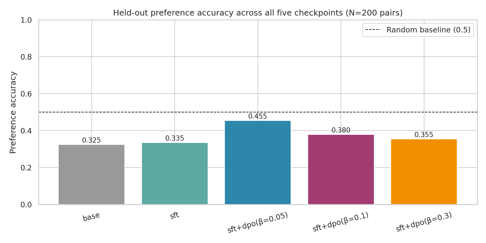

# SFT vs DPO with LoRA on Qwen2.5

This Deep Learning final project compares two parameter-efficient alignment approaches for the `Qwen/Qwen2.5-1.5B-Instruct` language model:

- Supervised fine-tuning (SFT) on preferred responses
- Direct Preference Optimization (DPO) initialized from the SFT adapter

The experiment uses LoRA adapters and evaluates a DPO beta sweep (`0.05`, `0.1`, and `0.3`) on held-out preference pairs from `argilla/ultrafeedback-binarized-preferences-cleaned`.

## Key result

On 200 held-out preference pairs, DPO with beta `0.05` achieved the strongest preference accuracy (`0.455`), compared with `0.335` for SFT and `0.325` for the base model. Full results are available in [`results/preference_accuracy.csv`](results/preference_accuracy.csv).

## Experiment design

| Component | Configuration |
| --- | --- |
| Base model | Qwen2.5-1.5B-Instruct |
| Dataset | UltraFeedback binarized preferences |
| SFT training set | 5,000 chosen responses |
| SFT training | 1 epoch |
| DPO training | 3 epochs per beta value |
| LoRA | rank 16, alpha 32, dropout 0.05 |
| Evaluation | mean response-token log-probability on 200 held-out preference pairs |

## Repository contents

- [`sft_vs_dpo_qwen_lora.ipynb`](sft_vs_dpo_qwen_lora.ipynb): reproducible Colab notebook for training, evaluation, generation, and plots.
- [`results/`](results): training logs, evaluation metrics, and figures.
- [`final_report.pdf`](final_report.pdf): project report.

## Results



The project also includes SFT loss, DPO reward curves, beta-sweep, and generation-statistics plots in [`results/`](results).

## Reproduction

The notebook is designed for Google Colab with a GPU runtime. Install the pinned dependencies in the notebook, mount Google Drive when prompted, and run the sections in order.

```text
transformers==4.44.2
trl==0.11.4
peft==0.13.2
accelerate==1.0.1
datasets==3.0.1
bitsandbytes
matplotlib
seaborn
pandas
```

The trained LoRA adapters and ZIP archives are intentionally excluded from this public repository because they are large binary artifacts. The notebook will regenerate them when run on a compatible GPU environment.

## Notes

The work is an academic project. Results reflect the stated model, data subset, hyperparameters, and evaluation protocol rather than a general claim about all SFT or DPO configurations.
